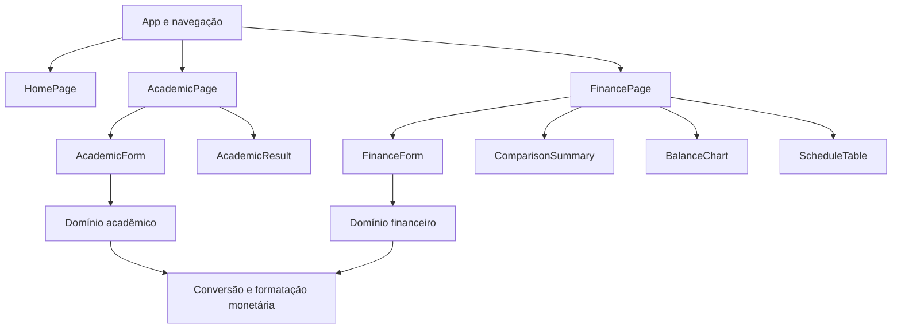
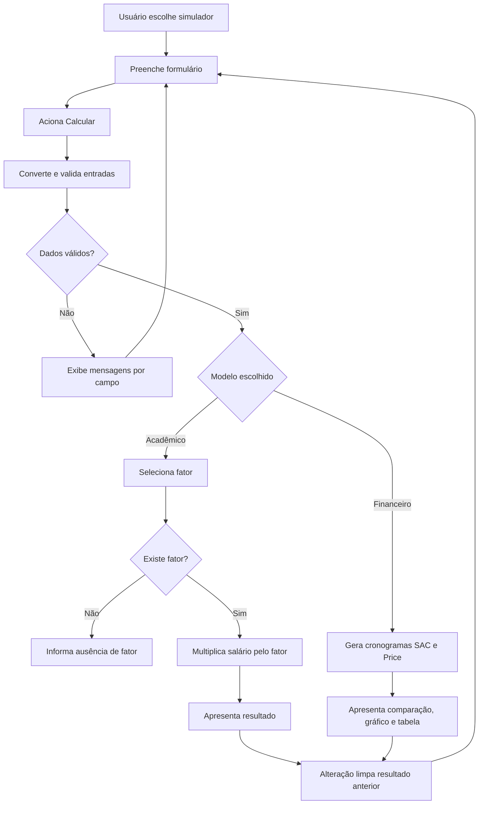

# SimuLAR — Arquitetura e experiência

Etapa 2, versão 1.0, 02/11/2026. Projeto de software, ainda sem implementação.

## Objetivo

Uma aplicação React + TypeScript com home inspirada em sites de imobiliárias e dois simuladores: o modelo acadêmico da página 4 do PDF e uma comparação financeira SAC/Price. A home conecta as experiências sem misturar suas regras.

## Navegação

| Rota | Conteúdo | Ação principal |
|---|---|---|
| `/` | Home SimuLAR | Comparar financiamentos |
| `/simulador` | Comparação SAC/Price | Calcular e comparar |
| `/exercicio` | Cálculo por sexo, idade e salário | Calcular valor pelo fator |

Usar rotas por hash inicialmente (`/#/simulador`), permitindo hospedagem estática sem configuração de redirecionamento. Logotipo retorna à home. Navegação funciona com teclado e histórico do navegador.

## Home

Marca: **SimuLAR**. Nome preservado com essa capitalização.

Direção visual: fundo claro, verde escuro, acentos em terracota, títulos amplos e imagem residencial. Conteúdo em português brasileiro. Linguagem acolhedora e objetiva, sem alegações de ofertas bancárias ou aprovação de crédito.

Sequência de conteúdo:

1. Cabeçalho com marca, links para os simuladores e botão “Simular financiamento”.
2. Destaque principal: “Seu próximo lar começa com uma boa simulação”. Texto explica entrada, prazo e comparação de parcelas. Imagem de arquitetura residencial com origem registrada.
3. Explicação curta de SAC e Price, com acesso ao comparador.
4. Seção “Como funciona”: informe os valores, compare cenários e consulte a evolução das parcelas.
5. Acesso ao “Modelo acadêmico”, explicitando o cálculo por fator do exercício.
6. Rodapé com identificação de projeto acadêmico e acesso às referências.

Não incluir anúncios de imóveis, depoimentos, contatos ou números comerciais fictícios. A aparência de imobiliária não implica um catálogo de imóveis nem serviços de corretagem.

## Componentes e responsabilidades



O domínio não importa React, não acessa DOM, não lê campos e não formata textos visuais. As páginas controlam estados e chamam funções puras. Componentes de resultado recebem dados já calculados. Estado permanece em memória, sem persistência dos dados pessoais.

## Organização proposta

```text
src/
  app/App.tsx
  pages/HomePage.tsx
  pages/AcademicPage.tsx
  pages/FinancePage.tsx
  components/layout/Header.tsx
  components/layout/Footer.tsx
  components/academic/AcademicForm.tsx
  components/academic/AcademicResult.tsx
  components/finance/FinanceForm.tsx
  components/finance/ComparisonSummary.tsx
  components/finance/BalanceChart.tsx
  components/finance/ScheduleTable.tsx
  domain/academic.ts
  domain/finance.ts
  domain/money.ts
  styles/global.css
  test/setup.ts
```

Testes de domínio ficam próximos aos respectivos módulos. Testes de página verificam fluxos e acessibilidade básica. Vite fornece desenvolvimento e build, Vitest executa testes, React Testing Library verifica interação e GitHub Actions executará a CI.

## Contratos do domínio

```typescript
type Gender = 'masculino' | 'feminino';
type Issue = { field: string; code: string };
type Result<T> = { ok: true; value: T } | { ok: false; issues: Issue[] };

type AcademicInput = {
  gender: Gender;
  age: number;
  salaryCents: number;
};
type AcademicResult = { factor: number; mortgageCents: number };

type FinanceInput = {
  propertyCents: number;
  downPaymentCents: number;
  months: number;
  effectiveAnnualRatePercent: number;
};
type Installment = {
  month: number;
  openingBalanceCents: number;
  interestCents: number;
  amortizationCents: number;
  paymentCents: number;
  closingBalanceCents: number;
};
type Schedule = {
  system: 'SAC' | 'PRICE';
  installments: Installment[];
  totalInterestCents: number;
  totalPaymentsCents: number;
};

// Assinaturas planejadas, sem implementação nesta etapa.
declare function parseMoney(raw: string): Result<number>;
declare function calculateAcademic(input: AcademicInput): Result<AcademicResult>;
declare function compareFinancing(input: FinanceInput): Result<{
  principalCents: number;
  sac: Schedule;
  price: Schedule;
}>;
```

Erros de entrada são resultados discriminados, não exceções lançadas durante o fluxo normal. A camada visual traduz códigos como `AGE_OUT_OF_RANGE` e `NO_FACTOR` para mensagens em português. Isso adapta a proposta inicial de exceções em C++ ao formulário React.

## Fluxo de cálculo



## Matemática do comparador

A primeira versão usa juros fixos e taxa **efetiva anual** informada pelo usuário. Não carregar uma taxa “atual do Brasil” sem fonte, data e identificação de modalidade.

- Principal P = valor do imóvel − entrada.
- Taxa mensal i = (1 + taxa efetiva anual / 100)^(1/12) − 1.
- SAC: amortização teórica A = P/n, juros do mês = saldo anterior × i.
- Price: prestação teórica T = P × i / (1 − (1+i)^(-n)).
- Quando i = 0, ambos amortizam P/n, sem juros e sem divisão por zero.

Dinheiro entra e sai em centavos inteiros. Arredondar juros mensais ao centavo mais próximo. No SAC, ajustar amortização residual no último mês. Na Price, usar a prestação arredondada, calcular amortização como prestação menos juros e ajustar a última prestação para liquidar o saldo. Verificar a cada mês saldo não negativo e, ao final, saldo zero. Exibir eventual ajuste da última parcela em vez de prometer parcelas absolutamente idênticas.

Comparar os dois sistemas com os mesmos P, n e i. O total das prestações inclui principal e juros; o desembolso com entrada é um total separado. Seguros, tarifas, tributos e atualização por TR/IPCA não fazem parte desta versão. Não chamar os resultados de CET.

Limites de produto propostos: imóvel de R$ 1,00 a R$ 100.000.000,00; entrada não negativa e menor que o imóvel; prazo inteiro de 1 a 600 meses; taxa efetiva anual entre 0% e 100%. Esses limites são proteções do simulador, não critérios bancários de elegibilidade. Caso o arredondamento torne a amortização inviável para valores mínimos e prazo longo, retornar erro orientando aumentar o principal ou reduzir o prazo.

## Estados e acessibilidade

Cada simulador tem estados inicial, inválido e calculado. Mudanças nas entradas removem resultados antigos. Campos possuem rótulos e mensagens associadas, resumo de erro recebe foco após tentativa inválida, e a conclusão do cálculo é anunciada por região acessível. O gráfico tem tabela equivalente. Em celular, conteúdo se reorganiza em uma coluna e a tabela mensal fica em região própria com rolagem horizontal.

## Evolução e evidências

Etapa 3: preparar repositório, issues e estrutura de projeto. Etapa 4: implementar home e domínio acadêmico, depois comparador. Etapa 5: verificar fronteiras, fórmulas, taxa zero, arredondamento, saldo final e interface. Etapas 6 e 7: CI e evidências reais.

Atualizar apresentação de 15 minutos com marca, navegação e arquitetura. Capturas, taxas reais e métricas de testes só entram após implementação ou consulta verificável.

Referências conceituais já consultadas na conversa:

- PDF do projeto, página 4.
- https://www.caixa.gov.br/Downloads/habitacao-documentos-gerais/passos_indexadores_amortizacao.pdf
- https://www.bcb.gov.br/estatisticas/txjuros
